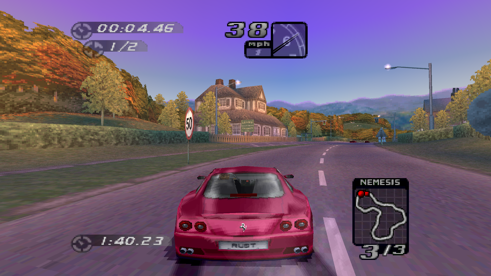
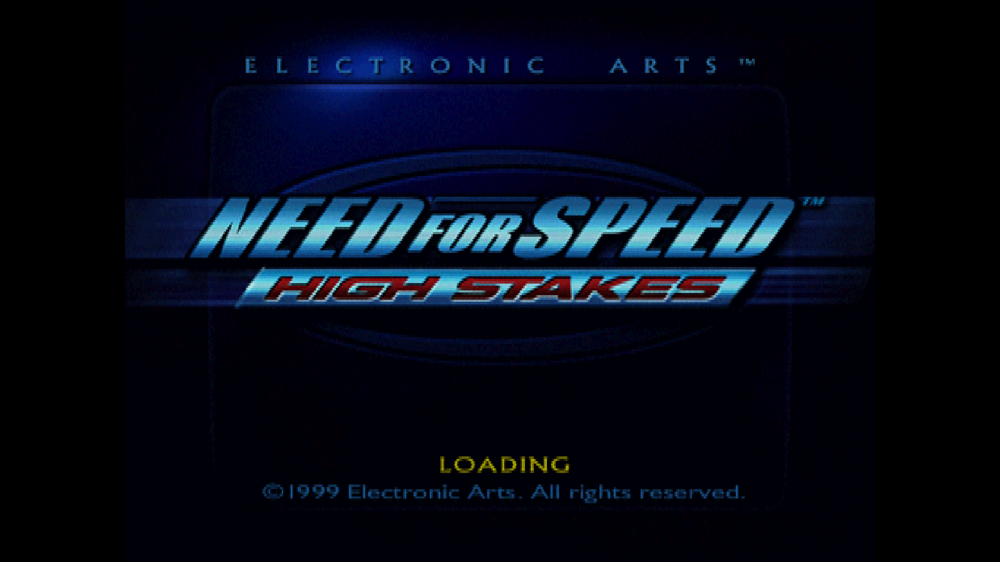
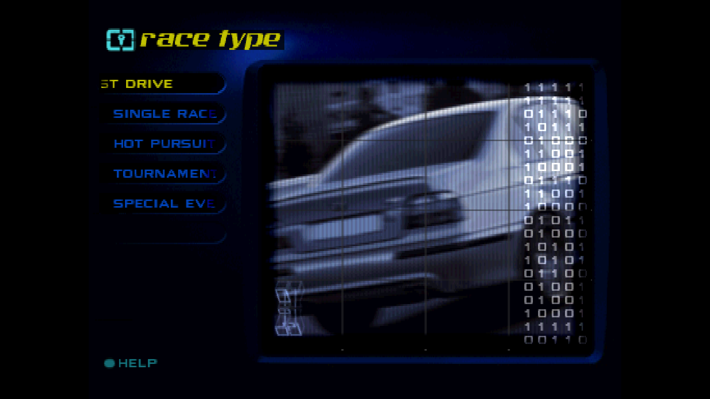
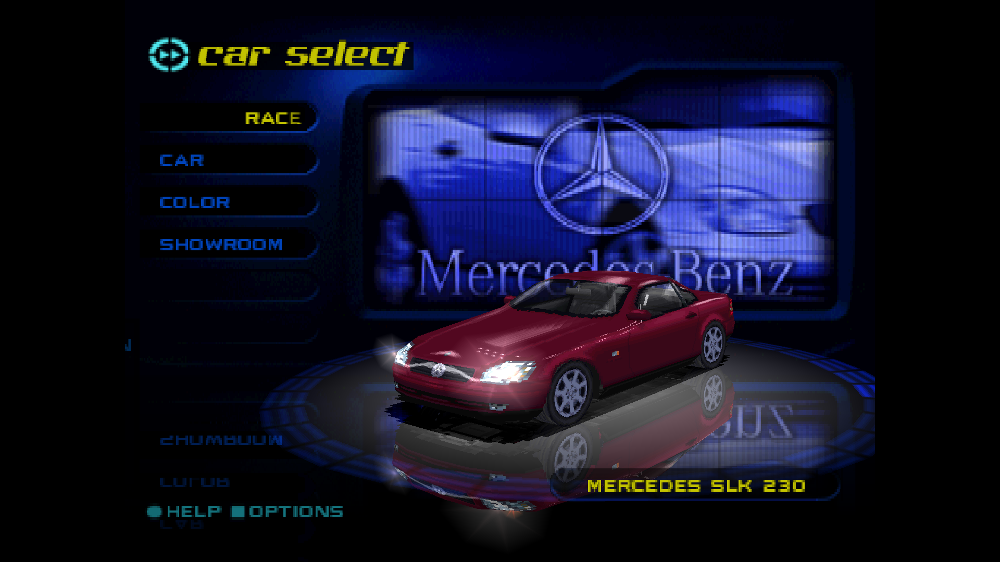
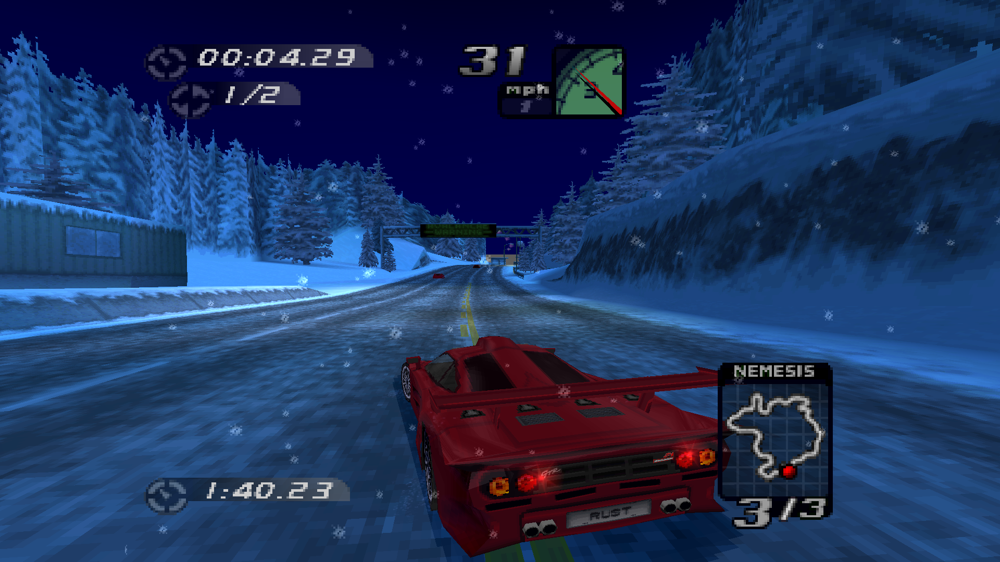

# nfshs-rs — Need for Speed: High Stakes (PS1) rebuilt for PC in Rust

Runs the original PlayStation release of *Need for Speed: High Stakes* (NTSC-U, SLUS-00826)
natively on PC. The game's own code drives everything (front end, races, physics, AI,
sound) and a new renderer draws it at any resolution and frame rate. Everything is loaded
from your own disc image: no emulator, and no game data in this repository.



| | |
|---|---|
|  |  |
|  |  |


## How it works

- **The original code, recompiled.** `NFS4.EXE` and its front-end overlay are statically
  recompiled to Rust (`crates/nfs4rc`, generated by `tools/recomp.py` from your disc's
  executable) and run on a small PS1 runtime (`crates/ps1rt`: CPU state, GTE, memory).
  Menus, game modes, car physics, AI, traffic, police, damage, the camera and the HUD logic
  are the game's own, step for step.
- **The hardware, replaced.** The PS1's libraries are high-level replacements in
  `src/ps1/host/`: CD and files read from the extracted disc; the pads come from keyboard
  and gamepads, with DualShock analog and vibration; the memory card is an image file;
  timers and VSync drive the game at 60 Hz; the SPU is modelled so the game's own EA sound
  driver plays its music and effects.
- **A new renderer.** The game's GPU output is never shown. The host records what the game
  decided to draw (track chunks, cars and their parts, light glows, smoke, weather, HUD and
  menus) and `src/game` + `src/render` draw it with wgpu. The 3D (track, cars, sky) is
  rebuilt from the original assets and drawn at full precision. The 2D the game builds in
  screen space (HUD, menus, glows, the sun) is redrawn from its primitives, moved to match
  the interpolated camera.
  Rendering runs at the display's rate, interpolated between the game's 60 Hz steps, and
  the 3D widens to fill wide windows.

Formats and findings are in [`docs/FORMATS.md`](docs/FORMATS.md); the diagnostic switches in
[`docs/DEBUGGING.md`](docs/DEBUGGING.md).

## What works

Everything a player of the original sees, with these known gaps (see the end of this file):

- **Front end**: the original menus, showroom (turning cars, light halos, shadow), the track
  select's spinning 3D track video, trophies, two-player car select and options, where a
  Graphics screen (window mode, resolution, texture filter, CRT filter, bloom, antialiasing)
  takes the Memory Card screen's place. FMV (STR video with XA audio) plays. Every track and car is unlocked
  (`NFSHS_LOCKED=1` keeps the save's progress instead).
- **Races**: all tracks and conditions (day, night, wet, snow, weather) and the game's modes
  as its own code runs them. Test drive, single race, Hot Pursuit (police, liveries) and
  two-player split screen have been checked against the original; career modes run the
  same code but have had less testing. Traffic, the original cameras (intro fly-by,
  bumper, close, far), pause menu and results all work.
- **Cars**: the original models with reflections, lit brake lights and headlights, dents,
  number plates, light halos, tyre marks and smoke.
- **Sound**: the game's own music and effects through the modelled SPU.
- **Input**: keyboard and gamepads. A gamepad acts as a DualShock in analog mode (stick
  steering, as unramped as on the PS1) and its motors drive the gamepad's rumble. A second
  gamepad is player 2. Gamepads can be plugged in or pulled out mid-race.
- **Memory card**: a raw 128 KiB `.mcd` image, the same format as DuckStation's, so saves
  move between the two. The game loads it at start and saves to it by itself: back at the
  main menu after a race or from the game options, and on quitting (Quit, or closing the
  window in the menus). `autosave = false` in `nfshs.ini` brings the original's question
  after a race back.

## Build & run

Requires Rust (stable), Python 3 (for the recompiler) and your own copy of the game disc
image.

```sh
# extract the disc (once)
cargo build --release
./target/release/nfshs extract "Need for Speed - High Stakes (USA).bin" gamedata
# generate the recompiled game from gamedata/NFS4.EXE (once, ~2 minutes to build after)
cd tools && python recomp.py ../crates/nfs4rc/src --all && cd ..
cargo build --release
# play (gamedata/ is found next to the project or the executable; or --data DIR / NFSHS_DATA)
./target/release/nfshs
# the settings (frame rate, texture filtering, mipmaps, CRT filter...) are in nfshs.ini,
# written with the defaults on the first start; --fps N and --bilinear override it
./target/release/nfshs --fps 144
# or straight into a race
./target/release/nfshs play --track 5 --variant N --car F375 --opponents MCF1,DIAB --laps 3
```

Tracks: `0` Snowy Ridge, `2` Dolphin Cove, `3` Route Adonf, `4` Kindiak Park, `5` Celtic Ruins,
`6` Landstrasse, `7` Durham Road, `8` Raceway 2, `9` Raceway, `10` Raceway 3.
Conditions (`--variant`): none = day, `N` night, `W` wet, `S` snow.

### Controls

Races (the game's default layout: Cross accelerates, Square brakes, Circle handbrake):

| Action | Keyboard | Gamepad |
|---|---|---|
| Accelerate / brake–reverse | Up / Down (W / S) | RT / LT (or A / X) |
| Steer | Left / Right (A / D) | Left stick or d-pad |
| Handbrake | Space | B |
| Camera | C | Y |
| Pause | Esc | Start |
| Confirm (results screens) | Enter | A |

Menus:

| PS1 button | Keyboard | Gamepad |
|---|---|---|
| D-pad | arrows | d-pad / left stick |
| Cross (accept) | Enter / Space | A |
| Triangle (back) | Esc | Y |
| Circle | Backspace | B |
| Square | Tab | X |
| Start | F1 | Start |

`P` toggles a test autopilot in races, `F3` the frame-rate counter, `F4` bilinear texture filtering, `F5` fullscreen, `F6` a CRT screen filter and `F7` bloom (for the session; `nfshs.ini` sets how the game starts, and the game options' Graphics screen writes its choices there).

### Settings (nfshs.ini)

`nfshs.ini` holds the player's settings, each with a comment: the display (windowed, borderless or fullscreen, the resolution, a frame rate held without vsync, the frame-rate counter, antialiasing and supersampling), the textures (nearest or bilinear filtering, mipmaps and their bias), the CRT filter and its look (curvature, aperture grille, scanlines, gamma, brightness, vignette), bloom (its intensity and threshold), gamepad vibration, the audio device, the memory card, autosaving and locked tracks and cars. It is read from the current directory or next to the executable, else beside the game data folder (where it is written with the defaults when there is none; `--config FILE` for another). The game reads it again whenever it is saved, so the settings can be tried while playing. Deleting it brings the defaults back.

### Settings (environment variables)

These override nfshs.ini.

| Variable | Effect |
|---|---|
| `NFSHS_DATA=DIR` | the extracted disc, if not found automatically |
| `NFSHS_MEMCARD=FILE` | the memory card image (default `memcard.mcd` next to the data folder); a DuckStation card works as is |
| `NFSHS_LOCKED=1` | keep the save's locked tracks and cars |
| `NFSHS_NO_RUMBLE=1` | no gamepad vibration |
| `NFSHS_AUDIO_DEVICE=name` | an audio output other than the default (part of its name) |
| `NFSHS_FPS=1` | print the frame rate |
| `NFSHS_TRAFFIC=N` | traffic density for headless runs |

## Developer tools

```
nfshs shot --track N --time S --keys u|a --out x.png [--bilinear] [--mipmaps] [--supersample N] [--msaa N]   headless race + screenshot
nfshs fe-play SCRIPT SHOTS DIR      the whole app headless: SCRIPT "secs:keys,..."
                                    (x t c s p u d l r, a autopilot, g a gamepad that step)
nfshs boot-race --track N --car C   headless original race, car states per step
                                    (BOOT_SCRIPT="8:-,3:x")
nfshs ref-compare DIR               render a DuckStation RAM capture as this engine would
nfshs dump-psh | dump-car | dump-track | dump-audio | dump-movie   asset viewers
nfshs verify-decompress <files>     codecs against re/dec/*.bin
```

`tools/` holds the reverse-engineering helpers: the recompiler, disassemblers, and DuckStation
automation for reference captures (`dsref.py`, with save states in `re/states`). See
[`tools/README.md`](tools/README.md).

Symbol maps (retail ↔ development build) are in `re/*.tsv`.

## Not done yet

- Options beyond the original's: key remapping, more video settings (frame cap,
  supersampling), audio sliders.
- PC improvements planned in `TODO.txt` (higher-quality UI and textures, custom music,
  mods).
- Car label textures show a faint outline at high resolution (the textures' own edge
  pixels; mipmapped car textures would hide it).
